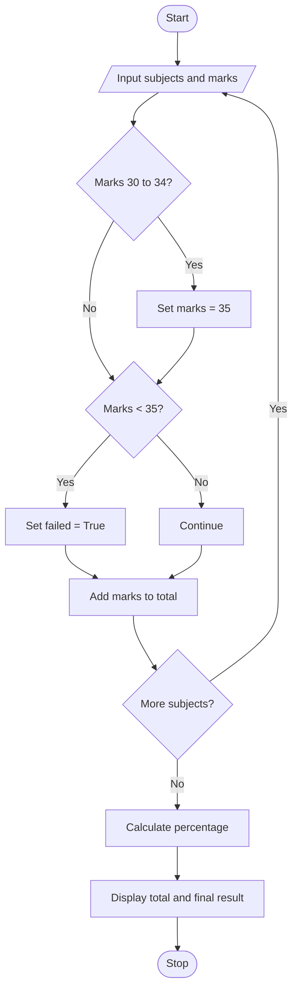

## 1. Problem Statement

Write a Python program to calculate a student's total marks and percentage in multiple subjects. Add grace marks if the marks are between 30 and 34. Display Pass or Fail for each subject and determine the final result based on the percentage.

## 2. Algorithm

1. Start.
2. Input the number of subjects.
3. Initialize `total = 0` and `failed = False`.
4. Enter marks for each subject.
5. If marks are between 30 and 34, increase them to 35.
6. Check whether the student passes or fails each subject.
7. Add the marks to the total.
8. Calculate the percentage.
9. Display the final result based on the percentage and failure status.
10. Stop.

## 3. Flowchart (Mermaid)




## 4. Sample Input

```
Enter number of subjects: 4
Enter marks: 80
Enter marks: 32
Enter marks: 65
Enter marks: 45
```

## 5. Sample Output

```
Pass
Grace marks added
Pass
Pass
Pass
Total marks: 225
Percentage: 56.25 %
Pass
```
