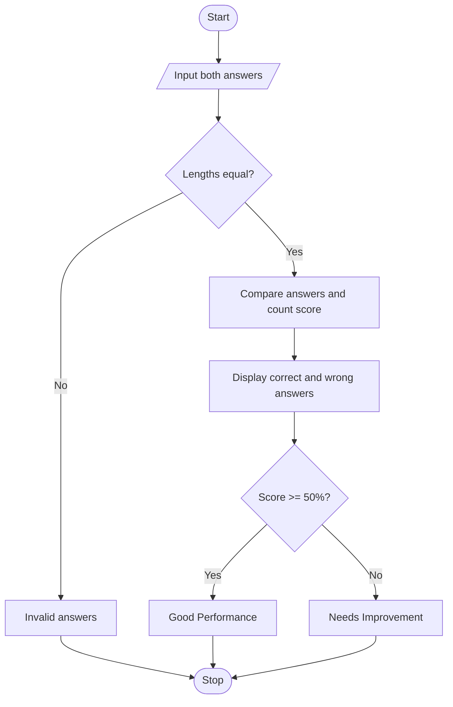

## 1. Problem Statement

Write a Python program to evaluate a student's answers by comparing them with the correct answers. Display the total questions, correct answers, and wrong answers. If the student scores at least 50%, display “Good Performance”; otherwise, display “Needs Improvement”.

## 2. Algorithm

1. Start.
2. Input correct answers and student answers.
3. If their lengths differ, display “Invalid answers”.
4. Otherwise, compare each answer and count correct answers.
5. Calculate wrong answers.
6. If the score is at least 50%, display “Good Performance”; otherwise, display “Needs Improvement”.
7. Stop.

## 3. Flowchart (Mermaid)


## 4. Sample Input

```
Enter correct answers: ABCD
Enter student answers: ABCE
```

## 5. Sample Output

```
Total Questions: 4
Correct Answers: 3
Wrong Answers: 1
Good Performance
```
