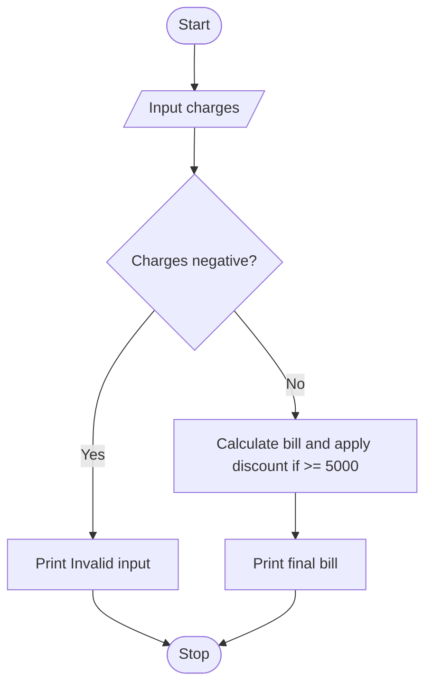

## 1. Problem Statement

Write a Python program to calculate a patient's final hospital bill using consultation and treatment charges. If any charge is negative, display “Invalid input”. If the total bill is ₹5,000 or more, provide a discount of ₹500.

## 2. Algorithm

1. Start.
2. Input consultation and treatment charges.
3. If any charge is negative, display “Invalid input”.
4. Otherwise, calculate the total bill.
5. If the total is ₹5,000 or more, subtract ₹500.
6. Display the final bill.
7. Stop.

## 3. Flowchart (Mermaid)




## 4. Sample Input

```
Enter consultation charge: 1000
Enter treatment charge: 4500
```

## 5. Sample Output

```
Final Bill: 5000.0
```

Explanation: Total bill = ₹1,000 + ₹4,500 = ₹5,500. After subtracting the ₹500 discount, the final bill is ₹5,000.
