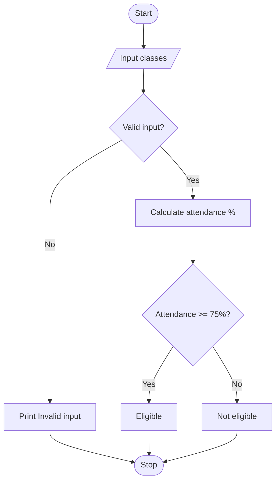

## 1. Problem Statement

Write a Python program to calculate a student's attendance percentage and check exam eligibility. A student is eligible for exams if attendance is 75% or above. Display “Invalid input” if the entered values are incorrect.

## 2. Algorithm

1. Start.
2. Input total classes and classes attended.
3. Check whether the input is valid.
4. Calculate attendance percentage.
5. If attendance is at least 75%, display “Eligible for exams”.
6. Otherwise, display “Not eligible for exams”.
7. Stop.

## 3. Flowchart (Mermaid)




## 4. Sample Input

```
Enter total classes: 100
Enter classes attended: 80
```

## 5. Sample Output

```
Attendance: 80.0 %
Eligible for exams
```
