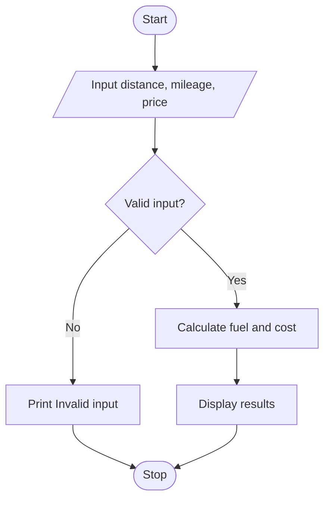

## 1. Problem Statement

Write a Python program to calculate the fuel required and total fuel cost for a journey based on distance, vehicle mileage, and fuel price. Display “Invalid input” if the entered values are incorrect.

## 2. Algorithm

1. Start.
2. Input distance, mileage, and fuel price.
3. Check whether the inputs are valid.
4. Calculate fuel required = distance / mileage.
5. Calculate total cost = fuel required × fuel price.
6. Display fuel required and total cost.
7. Stop.

## 3. Flowchart (Mermaid)

## 4. Sample Input

```
Enter distance in km: 200
Enter mileage in km per litre: 20
Enter fuel price per litre: 100
```

## 5. Sample Output

```
Fuel required: 10.0 litres
Total fuel cost: 1000.0
```
