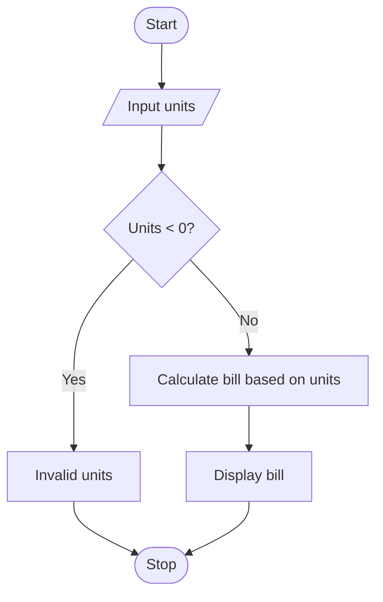

## 1. Problem Statement

Write a Python program to calculate an electricity bill based on the units consumed. The charges are ₹2 per unit for the first 100 units, ₹3 per unit for the next 100 units, and ₹5 per unit for units above 200. Display an error message if the units are negative.

## 2. Algorithm

1. Start.
2. Input units consumed.
3. If units are negative, display “Invalid units”.
4. If units are up to 100, calculate bill at ₹2 per unit.
5. If units are up to 200, charge ₹200 plus ₹3 per additional unit.
6. Otherwise, charge ₹500 plus ₹5 per additional unit.
7. Display the electricity bill.
8. Stop.

## 3. Flowchart (Mermaid)

## 4. Sample Input

```
Enter units consumed: 250
```

## 5. Sample Output

```
Electricity Bill: 750
```
