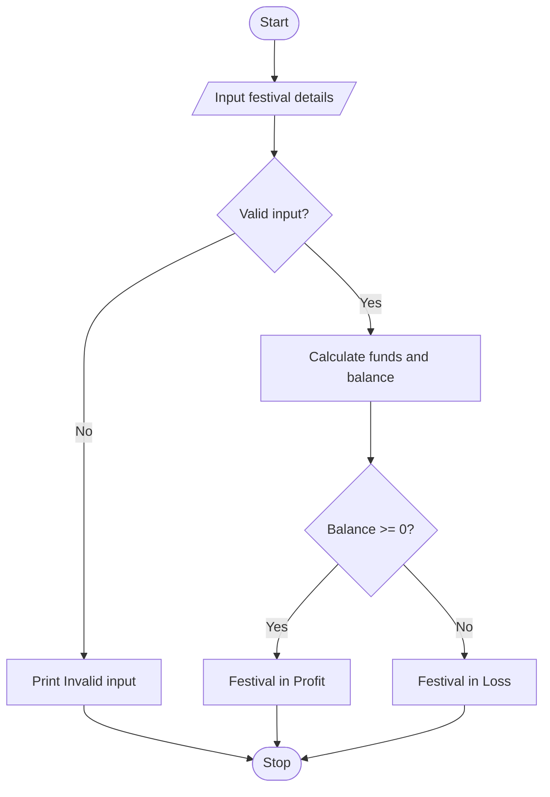

## 1. Problem Statement

Write a Python program to calculate the total funds and final balance for a college festival using student registration fees, sponsorship, and total expenses. Display whether the festival is in profit or loss.

## 2. Algorithm

1. Start.
2. Input students, registration fee, sponsorship, and expenses.
3. Check whether all inputs are non-negative.
4. Calculate registration amount and total funds.
5. Calculate final balance by subtracting expenses.
6. Display the results.
7. If balance is zero or positive, display Profit; otherwise, display Loss.
8. Stop.

## 3. Flowchart (Mermaid)


## 4. Sample Input

```
Enter number of students: 100
Enter registration fee per student: 200
Enter sponsorship amount: 10000
Enter total expenses: 15000
```

## 5. Sample Output

```
Registration Amount: 20000
Total Funds: 30000
Final Balance: 15000
Festival is in Profit
```
