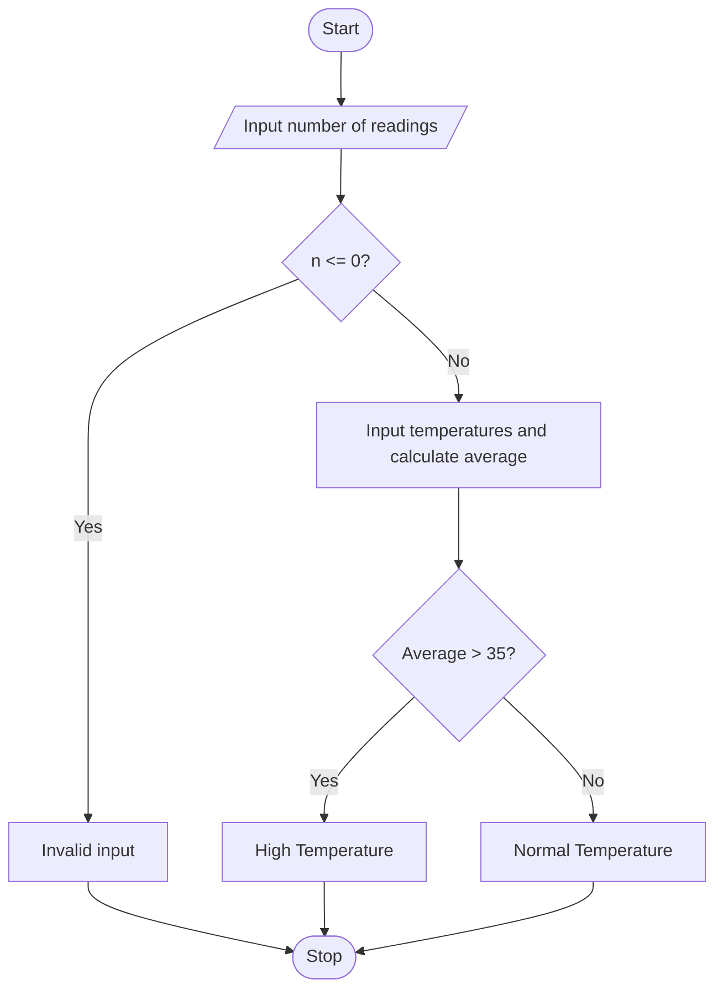

## 1. Problem Statement

Write a Python program to calculate the average temperature from multiple readings. If the number of readings is zero or negative, display “Invalid input”. If the average temperature is above 35°C, display “High Temperature”; otherwise, display “Normal Temperature”.

## 2. Algorithm

1. Start.
2. Input the number of readings.
3. If the number is less than or equal to zero, display “Invalid input”.
4. Otherwise, input temperatures and calculate their total.
5. Calculate the average temperature.
6. If the average is above 35°C, display “High Temperature”; otherwise, display “Normal Temperature”.
7. Stop.

## 3. Flowchart (Mermaid)

## 4. Sample Input

```
Enter number of readings: 3
Enter temperature: 36
Enter temperature: 38
Enter temperature: 34
```

## 5. Sample Output

```
Average Temperature: 36.0
High Temperature
```
