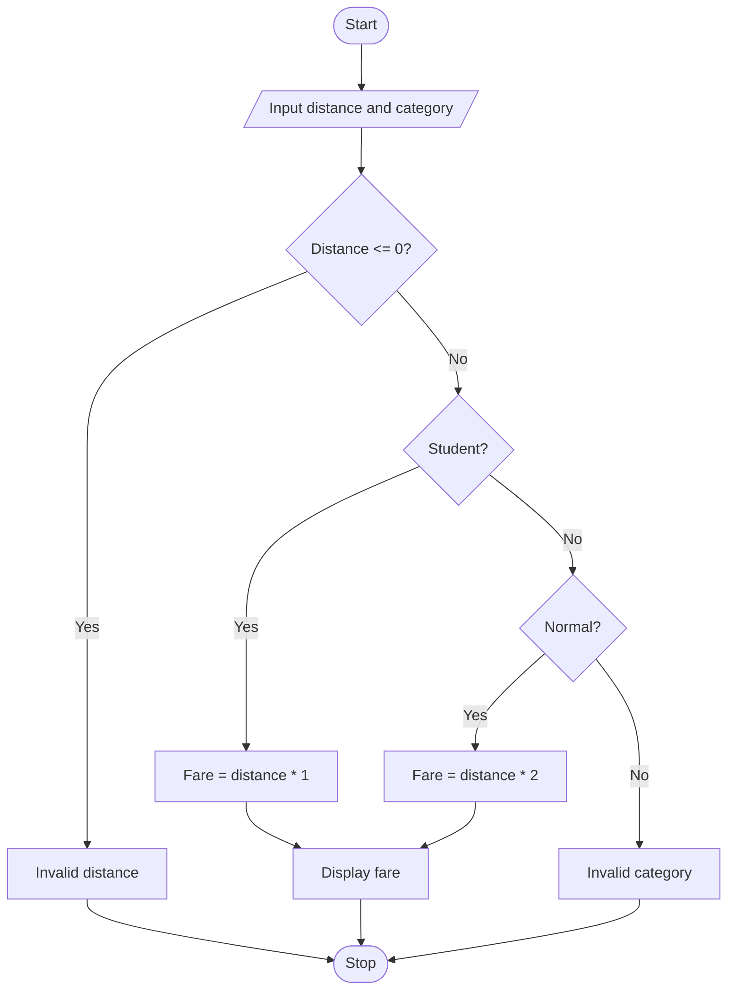

## 1. Problem Statement

Write a Python program to calculate bus fare based on travel distance and passenger category. Students pay ₹1 per kilometre, while normal passengers pay ₹2 per kilometre. Display an error message for invalid distance or category.

## 2. Algorithm

1. Start.
2. Input distance and passenger category.
3. If distance is less than or equal to zero, display “Invalid distance”.
4. If category is student, calculate fare at ₹1 per kilometre.
5. If category is normal, calculate fare at ₹2 per kilometre.
6. Otherwise, display “Invalid category”.
7. Display the fare and stop.

## 3. Flowchart (Mermaid)


## 4. Sample Input

```
Enter distance in km: 20
Enter category (student/normal): student
```

## 5. Sample Output

```
Student Fare: 20.0
```
